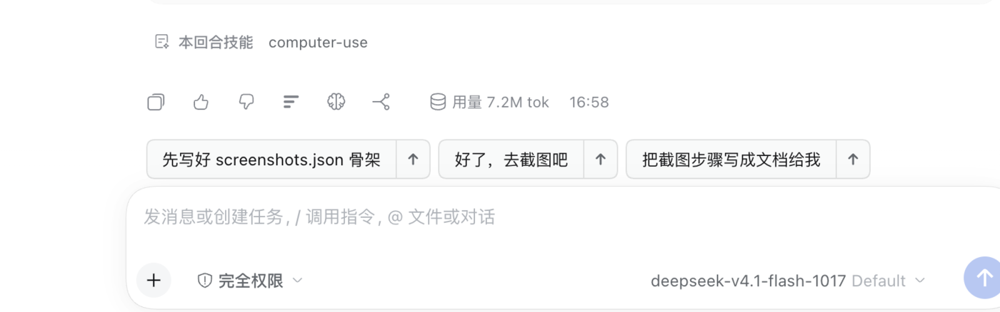

# dsh-follow-up-prompts

[English](README.md) | 简体中文

一个 [DeepSeek Harness](https://github.com/deepseek-ai) 插件：在输入框上方提示「接下来可以让我做什么」。

每轮回复正常结束后，插件用当前会话所在 provider 上的一个模型再问一次，最多得到三条后续指令，以卡片形式显示在输入框上方：

```
        ┌──────────────────────────────────┬───┐ ┌──────────────────────────────┬───┐ ╭───╮ ╭───╮
        │ Add unit tests for the parser    │ ↑ │ │ Run the full test suite      │ ↑ │ │ › │ │ × │
        └──────────────────────────────────┴───┘ └──────────────────────────────┴───┘ ╰───╯ ╰───╯
```

每条建议只有一段文本：**卡片上看到的就是点击 ↑ 真正发送的内容**。指令控制在 40 字以内，超过 40 字时卡片只显示前 40 个字符加省略号，完整文案交给悬停浮层；卡片宽度由文案长度决定，几条并排时宽度并不相等。

- **点击文案** —— 这条指令被填进输入框，你可以先改再发（会替换当前草稿）。
- **点击 ↑** —— 直接发送这条指令。
- **点击 › / ‹** —— 建议放不下时，整行可以横向滚动。右箭头直接滑到最后一条，左箭头回到第一条。箭头只在对应方向确实还有内容时才出现，滚动条本身隐藏。
- **悬停后点击 ×** —— 收起本轮建议；按 `Esc` 同样收起。右侧还有没展示的建议（出现 `›`）时 `×` 先让位，等滑到最右、`›` 消失后再出现。下一轮会重新出现。

## 环境要求

- DeepSeek Harness `>= 0.2.2-rc.5 < 0.3.0`（`engines.dsh`；不满足时 DSH 会拒绝安装或启用，用一个精确到版本的豁免可以强行装上，见 DSH 的插件版本豁免）。
- 无运行时依赖。

## 安装

已发布到 npm：[`dsh-follow-up-prompts`](https://www.npmjs.com/package/dsh-follow-up-prompts)，可以直接按包名安装：

```
plugin_manager install_bundle target=dsh-follow-up-prompts
```

想在本地改源码，就把目录作为 bundle 安装（本地目录安装是软链接，改完重启即生效）：

```
plugin_manager install_bundle target=/absolute/path/to/dsh-follow-up-prompts
```

然后重启 DeepSeek Harness，让 Host 与 Client 两半都加载。卸载用 `plugin_manager remove_bundle target=dsh-follow-up-prompts`。

## 1.1.4 有什么变化

只有打包变化，行为没动：发布出来的 tarball 现在带着自己的展示素材（`assets/icon-180.png`、`assets/screenshot-1.png`、`screenshots.json`），所以下面这张图在包内也能正常显示。从 1.1.3 升级只需重启。



## 1.1.3 有什么变化

- **建议不再跑在本轮的重模型上。** 建议只是三条短指令，复用刚回答完的重模型既慢又贵；长会话里它还是把请求推过超时线的直接原因。缺省 `auto` 会在同一 provider 内挑一个轻模型；provider 里没有更便宜的就沿用本轮模型，最坏情况退回旧行为，而不是让建议消失。
- **超时从 20 秒放宽到 30 秒。** 长会话偶发超过 20 秒才回第一个 token，被中止后一条建议都没有。
- **失败会留下痕迹。** 诊断日志现在能区分「保持本轮模型」（`suggest/model-kept`）、「选中的模型不可用，已退回」（`suggest/model-fallback`）和「撞上超时」（`suggest/timeout`），不再只是一行建议静默消失。排障时可以用 `DSH_FOLLOW_UP_PROMPTS_TIMEOUT_MS` 改超时阈值。
- **新增 `suggestionModel` 配置**固定选型：`auto`（缺省）、`session`、`provider/model` 或 `model`。

升级只需重启：已有安装保持缺省 `auto`，不需要额外配置。

## 工作原理

| 半边 | 文件 | 职责 |
| --- | --- | --- |
| Host | `index.js` | 按会话保留本轮的用户请求与助手回答，在 `turn/end`（`reason.kind === "completed"`）后调用一次模型，把 `plugin:dsh-follow-up-prompts/ready`（带 `ignorable` 标记）写入会话日志。 |
| Host | `index.js` | 把该事件折叠成 `followUpPrompts` projection，客户端读的就是它。 |
| Client | `client.js` | 在 `conversation.input.dock`（order 30）渲染卡片，只用主题 token 上色。 |

细节：

- 模型请求优先在同 provider 内换一个轻模型（缺省 `auto`：id 里带 `flash`/`mini`/`lite`/`small`/`instant`/`turbo`/`haiku`/`nano`/`fast` 的优先；没有可用的就沿用本轮模型），推理强度降到模型声明的最低档（通常是 `off`，DeepSeek 适配器会真正关掉 thinking），最多 1024 tokens，30 秒超时。建议只是短指令，不是推理任务；沿用 `high` 会让推理模型把预算全花在思考上，返回空文本。
- patch 条目的 `config.suggestionModel` 可以固定选型：`auto`（缺省）、`session`（沿用本轮模型）、`provider/model` 或 `model`。
- 最多保留三条建议；放不下时整行横向滚动。
- 建议只有 `prompt` 一个文本字段，因此卡片文案与发送内容不可能不一致。
- 子会话（subagent）不产生建议。
- `turn/start` 时清空上一轮建议并中止未完成的请求，不会闪回旧内容。
- 模型输出解析失败时，这一行就不显示。
- 写入面不可用时，建议条位置换成一行「建议功能不可用」，悬浮可看到具体原因；已经过期的旧建议不再展示。

## 兼容性与自检

写入会话日志依赖 DSH 的两个内部方法（`session.publicationEntry()` 与 `session.commit()`），它们没有对外契约，升级 DSH 时可能变化。插件的应对：

- **写不进去时不再空转**：首次发现写入面缺失就跳过模型请求，并在宿主日志打一条 `[dsh-follow-up-prompts]` 告警，而不是每轮静默没有建议。
- **界面上看得见**：写入面一旦失败，建议条位置显示「建议功能不可用」（而不是空着让人以为没有建议），写入恢复后自动换回建议。
- **不污染日志**：任何写入失败都只记录一条诊断信息，不会写出半截事件；事件本身始终带 `ignorable`，读取端认不出时也只是跳过，不会让会话打不开。
- **`engines.dsh` 收紧到已实测的大版本**：跨到 `0.3` 时 DSH 会在安装/启用阶段拦下，而不是运行到某一轮才发现建议消失。

升级 DSH 之后在仓库里跑一遍自检，比等某个会话打不开才发现要早（两个脚本只在源码仓库里，不随 npm 包发布）：

```
npm run canary     # 扫描会话日志：事件是否仍带 ignorable、是否混入会让读取端拒绝的旧类型
npm run selftest   # 用假宿主验证写入面可用/缺失/抛错、模型选型与超时诊断
```

`canary` 只读，退出码非 0 表示确实存在会让会话打不开的事件；它默认只看最近 14 天写过的会话，`--days N` 调窗口，`--all` 全量。

想在实际界面上确认提示行长什么样，可以带着 `DSH_FOLLOW_UP_PROMPTS_FORCE_UNAVAILABLE=1` 启动 DeepSeek Harness：插件把自己当作写入面不可用，不写事件也不调模型，只留那行提示。

## 隐私

本轮文本只发给会话本来就在使用的 provider。唯一的例外是你显式把 `suggestionModel` 指到别的 provider 上的模型，此时会发给那个 provider。除此之外不离开本机，也没有任何埋点。

## 文件

```
index.js            Host 半
client.js           Client 半
cordis.patch.yml    Bundle 补丁
locale/en.json      展示元数据（英文）
locale/zh.json      展示元数据（中文）
docs/DETAIL.md      插件列表里的详情页
docs/RELEASE.md     升版本号后的发版清单
scripts/canary.mjs  升级后自检（只读扫描会话日志）
scripts/selftest.mjs 写入面、模型选型与超时诊断的自检
icon.svg            插件图标
```

## 许可证

MIT